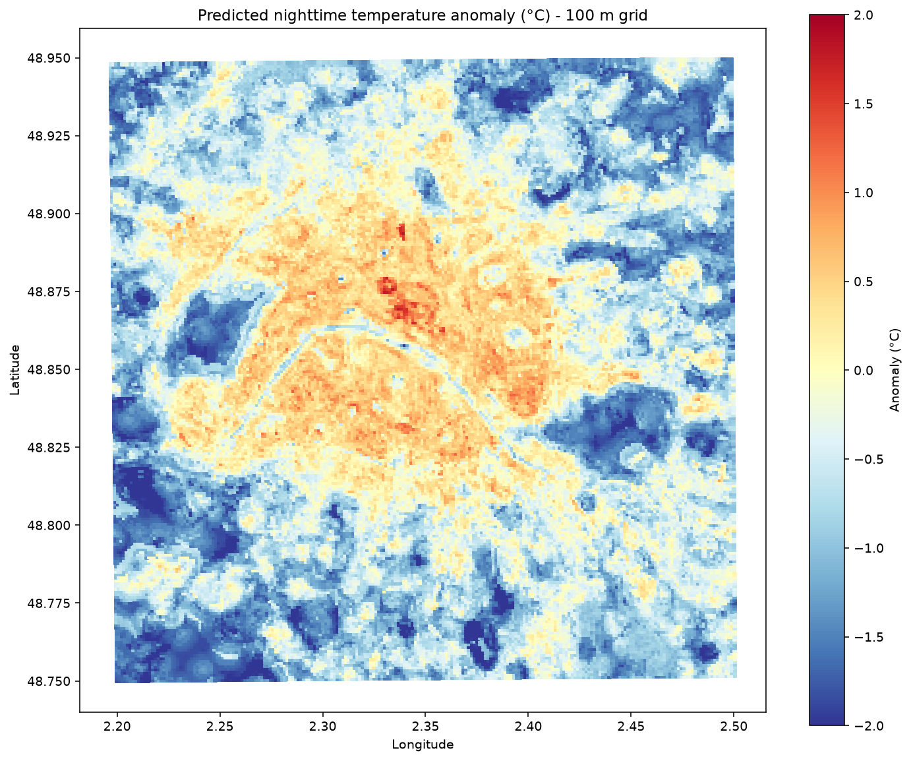
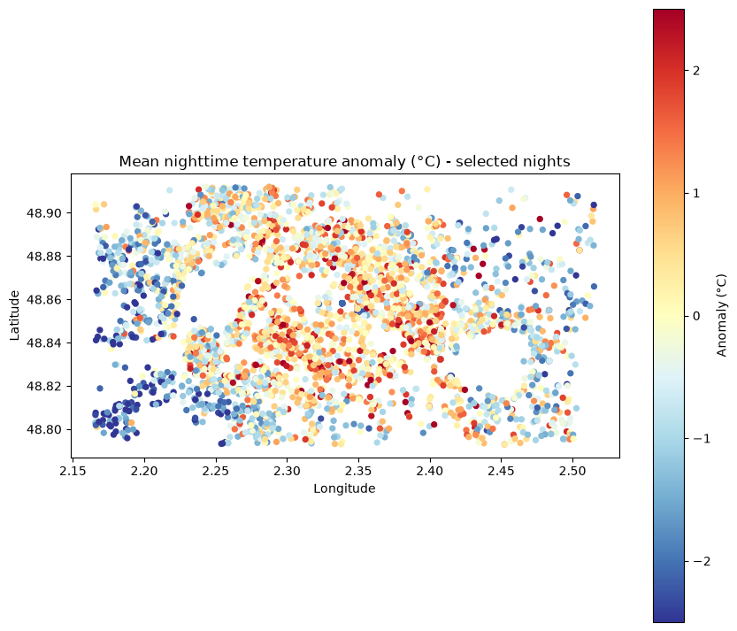

# Paris nighttime urban heat island, mapped with machine learning


This project maps Paris's nighttime urban heat island (UHI) with a pure machine-learning approach. A Random Forest learns from a network of citizen weather stations and urban descriptors from the IGN BD TOPO, then predicts the temperature anomaly on a regular grid. Under spatial validation the model beats a predict-the-mean baseline by about 10%, and this README reports that modest gain as it is.

| Predicted anomaly, 100 m grid | Observed anomaly, one point per station |
|---|---|
|  |  |

The two figures use different colour scales (±2 °C and ±2.5 °C) and cover different extents.

## Pipeline

1. **Collect.** A cron job polls the Netatmo `getpublicdata` API every 15 minutes over a tiled bounding box around Paris and deduplicates into SQLite. Netatmo gives no history for third-party stations, so the time series is built forward. (`collector/`)
2. **Select.** Calm summer nights are kept, using wind from Open-Meteo. The target is each station's mean **anomaly**, its deviation from the hourly city median, not its absolute temperature. (`notebooks/night_selection.ipynb`)
3. **Features.** Urban descriptors are computed in 100, 250 and 500 m buffers around each station from the IGN BD TOPO: built fraction, mean building height, vegetation fraction, plus distance to water and altitude. (`features/`)
4. **Model.** A Random Forest is validated with **spatial block cross-validation** and compared against two baselines. (`notebooks/night_selection.ipynb`)
5. **Map.** Predictions on a regular grid are exported as a static PNG and an interactive folium map. (`model/`)

## Results

Out-of-fold predictions for 3621 stations, 11 features, 5 folds over 119 spatial blocks of about 1.5 km (median 24 stations per block).

| Model | Validation | MAE (°C) | RMSE (°C) |
|---|---|---:|---:|
| Baseline: predict the mean | none (global mean) | 1.005 | 1.273 |
| Baseline: nearest station | spatial folds | 1.194 | 1.529 |
| **Random Forest** | **spatial block CV** | **0.900** | **1.143** |
| Random Forest | random k-fold, **leaky and optimistic** | 0.870 | 1.092 |

- **The honest number is the spatial one.** Random k-fold scores better only because test stations have correlated neighbours in the training set. It is shown for contrast and is not a claim about performance.
- **The gain is modest.** Against the mean baseline, the Random Forest lowers MAE by 10.4% and RMSE by 10.2%. Since the mean baseline's RMSE is close to the target's standard deviation, this corresponds to roughly 19% of the variance explained.
- **Copying the nearest station does worse than predicting the mean.** This is consistent with a large station-level noise component, which is also why the model's achievable error is bounded (see [Limitations](#limitations)).

<details>
<summary>Feature importance (Random Forest fitted on all 3621 stations)</summary>

| Feature | Importance |
|---|---:|
| `mean_height_100` | 0.170 |
| `mean_height_500` | 0.126 |
| `built_frac_250` | 0.118 |
| `built_frac_500` | 0.104 |
| `dist_water_m` | 0.095 |
| `altitude` | 0.091 |
| `veg_frac_500` | 0.070 |
| `mean_height_250` | 0.069 |
| `built_frac_100` | 0.065 |
| `veg_frac_250` | 0.051 |
| `veg_frac_100` | 0.041 |

</details>

<details>
<summary>Dataset behind these numbers (notebook snapshot)</summary>

| Step | Count |
|---|---:|
| Collection window of the snapshot | 2026-07-05 to 2026-08-15 |
| Hours actually recorded in that window | 556 (about 23 days, with a gap between 9 and 26 July) |
| Station-hours / stations collected | 1,628,380 / 3991 |
| Nights with data / selected | 25 / 20 |
| Station-hours in the core hours of selected nights / stations | 287,190 / 3935 |
| Stations seen on at least 4 nights | 3817 |
| Stations after quality control | 3625 |
| Stations with complete features, used for validation | 3621 |

</details>

## Methodology notes

- **Anomaly as the target, not absolute temperature.** Absolute temperature mostly teaches a model the weather of the day. Subtracting the hourly city median leaves the spatial pattern, which is what this project maps.
- **Spatial block CV, not random k-fold.** Neighbouring stations are correlated, so a random split leaks information. Stations are grouped into blocks of 0.02° and whole blocks are held out with `GroupKFold`.
- **Nights only, in a calm regime.** The UHI signal is at its clearest at night in calm air, which is also the regime that matters for health and adaptation. A night is kept if its mean wind between 23:00 and 04:59 is at most 10 km/h and it has at least 4 hours of data. The target uses the hours from 00:00 to 04:59 only.
- **Forward collection.** The API exposes only a snapshot with no history for third-party stations, so the dataset exists only because the collector ran over the summer. Large queries are also truncated, which is why the area is tiled.
- **Simple quality control.** A station must appear on at least 4 nights, its anomaly standard deviation must be below the network's 95th percentile, and its mean anomaly must stay within ±6 °C.

## Limitations

- **Valid for one regime only.** The model describes calm summer nights, with no skill claimed for any other weather.
- **The cloud filter is currently inactive.** The threshold exists in the notebook but is set to 100%, so nights are selected on wind alone and some selected nights are mostly overcast (mean cloud cover up to 86.2%). The regime is calm, not strictly calm and clear.
- **The map model differs from the validated model.** The metrics above include altitude (11 features). The grid has no altitude, so the map model is retrained without it (10 features) and has no separate validation score.
- **Label noise bounds the achievable error.** Sensor siting is unknown: a citizen station can sit on a sunny balcony or against a wall, and this cannot be separated from the urban signal.
- **Predictions are compressed toward the mean.** Station anomalies have a standard deviation of 1.27 °C and range from -5.44 to 4.65 °C, while the 200 m grid predictions have a standard deviation of 0.72 °C and range from -2.66 to 1.79 °C. The two populations cover different areas, but the shrinkage is expected from a Random Forest and hot and cold extremes are underestimated.
- **The anomaly reference is biased.** It is the median of the station network, which is spatially biased toward built-up areas, so zero does not mean a rural or regional reference.
- **Extrapolation in the large wooded parks.** There is no station coverage in the Bois de Boulogne and the Bois de Vincennes, so those cells are extrapolated. The same applies to the northern and southern edges of the grid (48.75 to 48.95° N), which extend beyond the station footprint.

## Roadmap

- Sky view factor from BD TOPO altitudes.
- Additional BD TOPO features: wall and roof materials, building use, dwelling counts.
- Stricter neighbour-based quality control with [CrowdQC+](https://github.com/dafenner/CrowdQCplus).
- A conditional model that takes weather as input, so it generalises beyond the calm-night regime.

## Setup and usage

Developed with Python 3.12.

```bash
git clone <repository-url> urbanHeatMap
cd urbanHeatMap
python3 -m venv .venv
source .venv/bin/activate
pip install -r requirements.txt
```

**Netatmo credentials.** Create an app on [dev.netatmo.com](https://dev.netatmo.com/apps/), generate a token with the `read_station` scope, and store the values in `collector/netatmo_tokens.json`, which is git-ignored:

```json
{
  "client_id": "YOUR_CLIENT_ID",
  "client_secret": "YOUR_CLIENT_SECRET",
  "refresh_token": "YOUR_REFRESH_TOKEN"
}
```

**BD TOPO.** Download the Ile-de-France GeoPackage and either extract it at the project root or set `BDTOPO_GPKG`. See [`data/README.md`](data/README.md).

**Collector.** Add this line with `crontab -e`, adapting the path:

```cron
*/15 * * * * cd /path/to/urbanHeatMap && .venv/bin/python collector/netatmo_collector.py >> data/cron.log 2>&1
```

**Run order**, once enough nights are collected:

```bash
python collector/netatmo_collector.py --status      # check the health of the collection
python exploration/plot_temperatures.py --days 30   # optional: overview of the signal

python features/compute_features.py                 # 1. station features, needs the BD TOPO

# 2. Run notebooks/night_selection.ipynb (e.g. with `jupyter lab`).
#    It selects the nights, runs the validation and exports data/station_target.csv.
#    Its last code cell also reads the grid predictions, so that read fails
#    on a first run. Re-run the cell after step 3.

python model/predict_grid.py --resolution 200       # 3. train and predict on the grid
python model/map_prediction.py --resolution 200     # 4. interactive map in data/
```

<details>
<summary>Repository layout</summary>

```text
collector/     Netatmo token management and the cron-driven collector
exploration/   Quick overview plot of the collected data
features/      BD TOPO feature logic (bdtopo.py) and station features
model/         Grid prediction and interactive map
notebooks/     Night selection, target, validation and feature importance
docs/images/   Figures used in this README
data/          Local data, empty in the repository (see data/README.md)
```

</details>

## Data sources

- **Observations:** [Netatmo Weather API](https://dev.netatmo.com/apidocumentation/weather) (`getpublicdata`).
- **Urban features:** [IGN BD TOPO](https://geoservices.ign.fr/bdtopo).
- **Reference weather:** [Open-Meteo Historical Weather API](https://open-meteo.com/en/docs/historical-weather-api).

Raw Netatmo data is not redistributed. This repository publishes the code and derived figures only, so reproducing the results requires running your own collection.

## License

[MIT](LICENSE)
